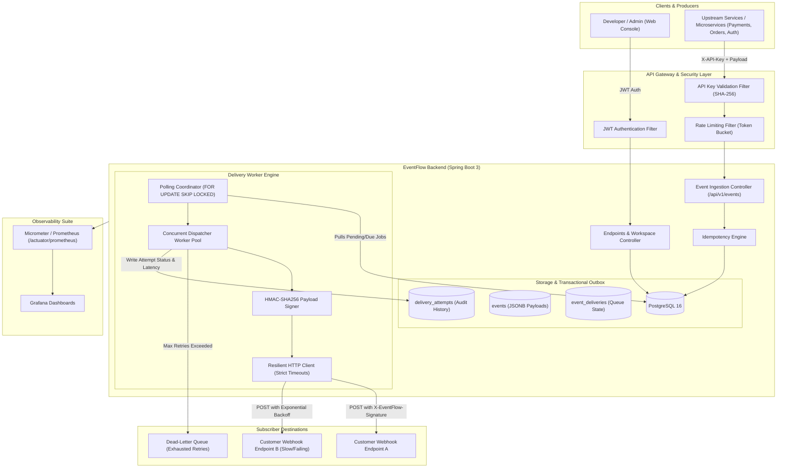
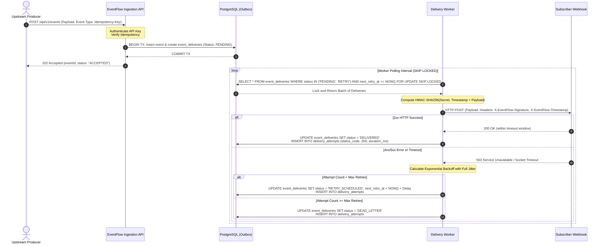
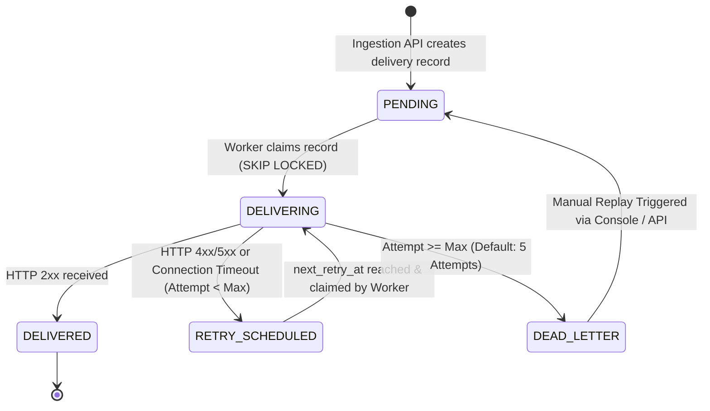
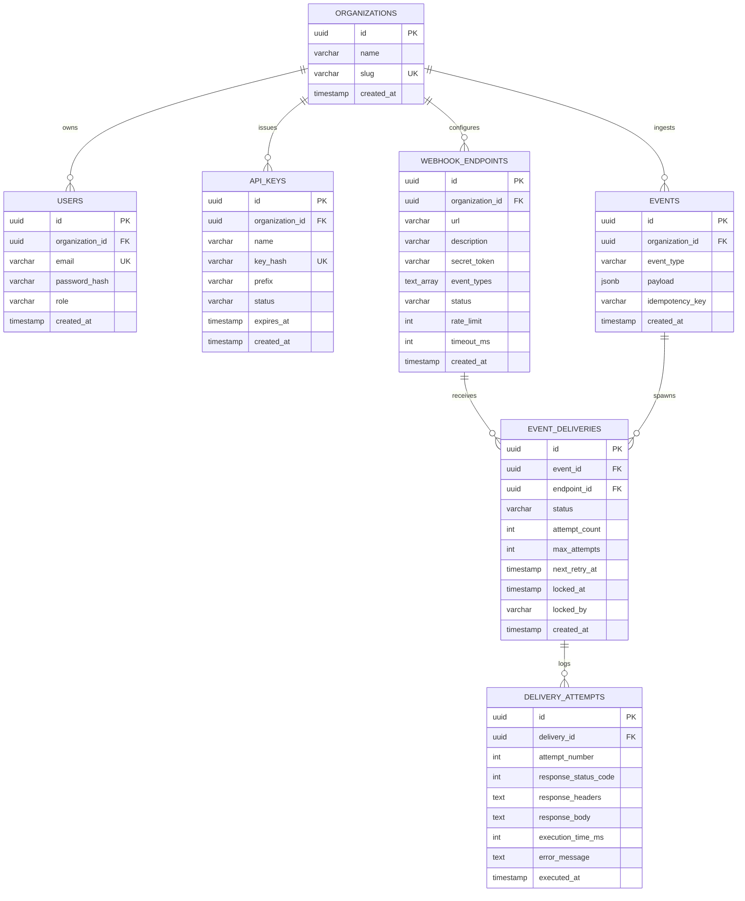

# EventFlow — System Architecture & Technical Specification

> **A Production-Grade Webhook Delivery & Event Processing Platform**  
> Designed for high-reliability event distribution, transactional durability, zero message loss, and real-time observability.

---

## 1. Executive Summary & Problem Statement

In modern distributed microservice architectures, event delivery via webhooks is deceptively complex. A naive HTTP `POST` call fails in production due to network partitions, subscriber downtime, cold starts, rate limits, and slow consumer backpressure.

**EventFlow** serves as a fault-tolerant, resilient delivery middleware:
1. **At-Least-Once Delivery Guarantee:** Webhooks are durably recorded in PostgreSQL before acknowledgment.
2. **Crash Resilience:** If a worker node crashes mid-flight, jobs automatically recover without duplication or dropped events.
3. **Smart Retries:** Exponential backoff with full jitter prevents thundering herd problems on struggling downstream systems.
4. **Security & Authenticity:** HMAC-SHA256 cryptographic signatures with timestamp headers prevent spoofing, tampering, and replay attacks.
5. **Observability:** Granular HTTP delivery logs, latency metrics, Prometheus instrumentation, and real-time dashboard tracking.

---

## 2. Technology Stack & Deep-Dive Decision Matrix

### 2.1 Overview Matrix

| Layer | Technology | Version | Primary Responsibility |
| :--- | :--- | :--- | :--- |
| **Language** | **Java** | 21 LTS | Core compiled backend language & concurrent runtime |
| **Backend Framework** | **Spring Boot** | 3.3+ | Microservice application container, DI, & web server |
| **API Security** | **Spring Security** | 6+ | Filter chains, authorization rules, & endpoint protection |
| **User Authentication** | **JWT (JSON Web Tokens)** | RFC 7519 | Stateless authentication for developer web console |
| **Ingestion Auth** | **API Keys (SHA-256)** | Custom Auth | High-performance machine-to-machine event ingestion |
| **Primary Database** | **PostgreSQL** | 16+ | Relational ACID persistence & JSONB payload storage |
| **Queue & Dispatcher** | **Durable PostgreSQL Queue** | `SKIP LOCKED` | Transactional Outbox pattern & lock-free worker polling |
| **Caching & Locks** | **Redis** *(Stage B/C)* | 7.x | Token-bucket rate limiting & distributed worker locks |
| **Frontend Framework** | **React** | 18 | Declarative component UI for Developer Dashboard |
| **Frontend Language** | **TypeScript** | 5.x | Static typing & strict API contract alignment |
| **API Documentation** | **Springdoc OpenAPI (Swagger)** | 3.0 | Living interactive documentation & client contract |
| **Unit & Mock Testing** | **JUnit 5 & Mockito** | 5.x / 5.x | Isolated unit tests for backoff, signing, & business logic |
| **Integration Testing**| **Testcontainers** | 1.20+ | Production-identical PostgreSQL Docker testing |
| **Containerization** | **Docker & Docker Compose** | 24+ / v2 | Multi-container environment parity & orchestration |
| **Metrics & Telemetry**| **Prometheus & Micrometer** | Latest | Time-series ingestion rate, delivery latency, & queue depth |
| **Visualization** | **Grafana** | Latest | Real-time observability dashboards for delivery SLAs |
| **Performance Testing**| **k6** | Latest | High-throughput load testing & queue saturation benchmarks |
| **Version Control & CI**| **Git & GitHub Actions** | Latest | Monorepo versioning & automated validation pipeline |

---

### 2.2 Detailed Technology Breakdown

#### 1. Java (JDK 21 LTS)
* **Definition:** A strongly typed, class-based, object-oriented compiled language running on the Java Virtual Machine (JVM), widely recognized for enterprise reliability and high-throughput server workloads.
* **Why Are We Using It?**
  * **Static Type Safety:** In mission-critical financial and event delivery systems, static typing prevents entire classes of runtime errors (e.g., null pointers, schema mismatches).
  * **Modern Concurrency (Virtual Threads / Project Loom):** Java 21 provides lightweight Virtual Threads, allowing millions of concurrent network I/O operations (like outbound HTTP webhook requests) without the resource overhead of OS-level threads or the mental complexity of reactive programming.
  * **Interview Relevance:** Demonstrates deep mastery of object-oriented design, design patterns, concurrency controls, and high-performance backend engineering.
* **Purpose in EventFlow:** Powers the entire core backend server, orchestrating event ingestion, payload validation, cryptographic signing, worker dispatch loops, and transactional database interactions.

---

#### 2. Spring Boot 3
* **Definition:** An opinionated, production-ready extension of the enterprise Spring Framework that provides auto-configuration, dependency injection, and embedded web servers (Apache Tomcat) out-of-the-box.
* **Why Are We Using It?**
  * **Rapid Production Readiness:** Ships with enterprise-grade non-functional requirements (Spring Boot Actuator for health checks, HikariCP for high-performance connection pooling, structured logging).
  * **Seamless Ecosystem:** Flawlessly integrates security, relational persistence (Spring Data JPA), caching, and REST controllers with minimal boilerplate.
  * **Mature Dependency Injection:** Keeps business logic, persistence layers, and transport controllers decoupled, testable, and maintainable.
* **Purpose in EventFlow:** Serves as the central application backbone—hosting the REST APIs, managing database transaction boundaries (`@Transactional`), scheduling worker polling loops (`@Scheduled`), and configuring connection pools.

---

#### 3. Spring Security
* **Definition:** A comprehensive and extensible authentication, authorization, and access-control framework specifically designed for securing Spring-based applications.
* **Why Are We Using It?**
  * **Pluggable Security Filter Chains:** Allows cleanly separating multiple authentication schemes (e.g., JWT for browser sessions and API Keys for automated microservices) without polluting controller logic.
  * **Exploit Protection:** Built-in defenses against Cross-Site Request Forgery (CSRF), Cross-Origin Resource Sharing (CORS) controls, and session fixation attacks.
* **Purpose in EventFlow:** Protects all administrative and developer console endpoints; verifies user permissions, validates authorization tokens, and isolates organizational workspaces.

---

#### 4. JWT (JSON Web Tokens)
* **Definition:** An open, industry-standard RFC 7519 method for securely transmitting digitally signed, compact, URL-safe claims between two parties.
* **Why Are We Using It?**
  * **Stateless Scalability:** The server does not need to store session records in memory or a database to verify a user; any horizontal replica can validate the signature using the shared secret key.
  * **Decentralized Claims:** Carries user identity, role, and organization ID within the payload itself, reducing redundant database lookups on authenticated requests.
* **Purpose in EventFlow:** Secures the Developer Web Console. When a developer logs in, EventFlow issues an access token used to authorize requests for managing webhooks, rotating keys, and triggering manual retries.

---

#### 5. API Keys (Salted SHA-256 Cryptographic Hashing)
* **Definition:** Unique, high-entropy secret string tokens passed in HTTP request headers (`X-API-Key`) designed for automated machine-to-machine authentication.
* **Why Are We Using It?**
  * **Non-Interactive Authentication:** Microservices and third-party systems publishing events need a persistent, reliable, and easily rotatable credential without interactive login flows.
  * **Zero-Knowledge Storage:** Keys are only shown once upon creation and stored in PostgreSQL as one-way salted SHA-256 hashes. Even if the database is compromised, the plaintext API keys cannot be recovered.
* **Purpose in EventFlow:** Authenticates external microservices pushing events to the `/api/v1/events` ingestion endpoint and dynamically maps the incoming event to the corresponding organization workspace.

---

#### 6. PostgreSQL 16+
* **Definition:** An advanced, open-source object-relational database management system (ORDBMS) renowned for strict SQL standards compliance, robust ACID guarantees, and advanced concurrency controls.
* **Why Are We Using It?**
  * **ACID Transaction Guarantees:** Ensures that an event ingestion and its initial delivery job are committed atomically—preventing ghost events or lost deliveries.
  * **First-Class JSONB Support:** Webhook event payloads vary widely between systems (e.g., Stripe, Shopify, custom events). PostgreSQL's `JSONB` format stores unstructured JSON efficiently with binary indexing capabilities.
  * **Locking Primitives:** Supports `SKIP LOCKED` row-level locking, enabling relational tables to behave like distributed queues.
* **Purpose in EventFlow:** Serves as the primary system of record for organizations, users, API keys, webhook endpoints, events, delivery attempts, and the underlying delivery queue.

---

#### 7. Durable PostgreSQL Job Queue (`SKIP LOCKED`)
* **Definition:** A concurrency architectural pattern utilizing the SQL standard query:
  $$\text{SELECT} \dots \text{FOR UPDATE SKIP LOCKED}$$
  which allows multiple concurrent worker processes to query and lock rows from a table while instantly skipping rows already claimed by another worker.
* **Why Are We Using It?**
  * **The Transactional Outbox Pattern:** By storing delivery jobs in the same PostgreSQL database as the incoming event, the entire ingest operation occurs inside a single local transaction. This guarantees zero message loss without the operational complexity or dual-write failure modes of Kafka/RabbitMQ in Stage A.
  * **Eliminates Thread Contention:** Traditional table-based queues suffer from table locks or deadlocks. `SKIP LOCKED` allows lock-free parallel execution across hundreds of worker threads.
* **Purpose in EventFlow:** Powers the reliable background delivery dispatcher. Worker threads claim batches of pending deliveries, execute HTTP dispatches, and update statuses without colliding or processing duplicates.

---

#### 8. Redis 7.x *(Stage B & C)*
* **Definition:** An in-memory, network-accessible, key-value data structure store used as a high-speed distributed cache, message broker, and synchronization primitive.
* **Why Are We Using It?**
  * **Sub-Millisecond Speed:** In-memory lookups provide near-zero latency for high-frequency operations.
  * **Distributed Primitives:** Provides atomic operations (`INCR`, `EXPIRE`) and distributed locks (Redlock / `SETNX`), essential for distributed coordination across horizontally scaled instances.
* **Purpose in EventFlow:** 
  1. Implements sliding-window and token-bucket **rate limiting** to prevent EventFlow from overwhelming external subscriber endpoints.
  2. Implements **distributed locks** to ensure only one worker instance performs leadership/reconciliation tasks.
  3. Caches active webhook endpoint configurations to reduce PostgreSQL read load.

---

#### 9. React 18 & TypeScript
* **Definition:**
  * **React:** A declarative, component-driven JavaScript library for rendering dynamic, reactive user interfaces with a virtual DOM.
  * **TypeScript:** A strongly typed superset of JavaScript that adds static type definitions and compile-time contract verification.
* **Why Are We Using It?**
  * **Type-Safe Contract Synchronization:** TypeScript interfaces mirror backend Spring Boot DTOs, preventing serialization/schema mismatch bugs before code is even deployed.
  * **Componentized State:** Enables rich, responsive developer experiences (e.g., expandable JSON payload viewers, live delivery status indicators, interactive retry buttons).
* **Purpose in EventFlow:** Powers the developer web dashboard, allowing engineering teams to configure webhook URLs, inspect real-time delivery logs, inspect HTTP headers, and manually replay failed webhooks.

---

#### 10. Springdoc OpenAPI / Swagger 3.0
* **Definition:** An automated specification generator and UI documentation framework that parses Spring Boot controller annotations to produce OpenAPI 3.0-compliant schemas.
* **Why Are We Using It?**
  * **Zero Documentation Drift:** Because the documentation is derived directly from live code controllers and DTOs, API docs can never fall out of sync with actual code behavior.
  * **Interactive API Testing:** Provides a built-in `/swagger-ui.html` sandbox for developers to test authentication, event publishing, and endpoint management directly in the browser.
* **Purpose in EventFlow:** Exposes complete, living API specifications and an interactive testing console for all developer-facing REST endpoints.

---

#### 11. JUnit 5, Mockito & Testcontainers
* **Definition:**
  * **JUnit 5:** The modern testing foundation and test execution engine for the Java ecosystem.
  * **Mockito:** A mocking framework used to simulate external dependencies and isolate units under test.
  * **Testcontainers:** A Java library that spins up lightweight, disposable Docker containers (e.g., actual PostgreSQL instances) during automated test runs.
* **Why Are We Using It?**
  * **Hermetic Real-World Testing:** Testing relational databases with in-memory H2 introduces false positives because H2 lacks PostgreSQL-specific features like `JSONB` and `SKIP LOCKED`. Testcontainers runs tests against genuine PostgreSQL containers.
  * **Fast Unit Tests:** Mockito allows testing complex retry formulas, exponential backoff with jitter, and HMAC cryptographic signing in milliseconds without network calls.
* **Purpose in EventFlow:** Validates all core algorithms with unit tests; verifies transactional atomicity, concurrency safety, and database schema migrations with automated integration tests.

---

#### 12. Docker & Docker Compose
* **Definition:**
  * **Docker:** An open platform for developing, shipping, and running applications inside isolated, lightweight container environments.
  * **Docker Compose:** A declarative CLI tool for defining and orchestrating multi-container Docker applications via YAML specification files.
* **Why Are We Using It?**
  * **Guaranteed Environment Parity:** Eliminates the "it works on my machine" problem by packaging the exact Java runtime, PostgreSQL version, and frontend build environment into reproducible images.
  * **Single-Command Orchestration:** Developers and evaluators can launch the entire system (backend, frontend, database, monitoring) with a single command: `docker compose up`.
* **Purpose in EventFlow:** Standardizes local development, provides containerized PostgreSQL and Redis services, and packages the Spring Boot backend and React frontend for production deployment.

---

#### 13. Prometheus, Grafana & Micrometer
* **Definition:**
  * **Micrometer:** A vendor-neutral application metrics facade for the JVM, acting as the SLF4J of metrics.
  * **Prometheus:** An industry-standard open-source monitoring and time-series database utilizing a pull-based scraping mechanism.
  * **Grafana:** A leading open-source platform for data visualization and interactive metric dashboards.
* **Why Are We Using It?**
  * **Mission-Critical Observability:** Webhook delivery platforms must provide real-time SLA visibility (P95/P99 latency, delivery success rates, queue lag, worker thread saturation).
  * **Proactive Alerting:** Enables configuring alerts for failing endpoints, worker backlog spikes, or database connection pool exhaustion.
* **Purpose in EventFlow:** Micrometer captures custom timers and counters inside the delivery worker; Prometheus scrapes the `/actuator/prometheus` endpoint; Grafana visualizes real-time delivery graphs and SLA health.

---

#### 14. k6 Load Testing
* **Definition:** A developer-centric, open-source performance testing tool developed by Grafana Labs, written in Go and scripted in ES6 JavaScript.
* **Why Are We Using It?**
  * **High Concurrency Efficiency:** Uses minimal CPU and memory compared to legacy tools (like JMeter), capable of generating tens of thousands of concurrent requests from a single local machine.
  * **Thresholds as Code:** Allows asserting performance SLAs directly in test scripts (e.g., `http_req_duration: ['p(95)<150']`).
* **Purpose in EventFlow:** Stress-tests the `/api/v1/events` ingestion endpoint to verify high-throughput ingestion limits and evaluates how fast the background worker pool drains queued deliveries under heavy load.

---

#### 15. Git & GitHub Actions
* **Definition:**
  * **Git:** A distributed version control system for tracking changes in source code repositories.
  * **GitHub Actions:** A CI/CD automation platform integrated into GitHub that automates build, test, and release workflows.
* **Why Are We Using It?**
  * **Continuous Quality Assurance:** Every pull request and push automatically triggers builds, executes checkstyle/linter rules, and runs the entire JUnit/Testcontainers test suite.
  * **Automated Packaging:** Automatically builds and pushes Docker images upon code merges.
* **Purpose in EventFlow:** Manages source code versioning for the monorepo and automates the continuous integration pipeline to ensure code health and prevent regressions.

---

## 3. High-Level System Architecture



---

## 4. End-to-End Event Lifecycle & Sequence



---

## 5. Delivery State Machine



---

## 6. Database Entity-Relationship (ER) Schema



---

## 7. Security Architecture: HMAC Webhook Verification

To guarantee that subscribers only accept authentic payloads originating from EventFlow, every dispatch signs the payload using an **HMAC-SHA256 signature**:

### Outgoing Headers
```http
POST /webhook/receiver HTTP/1.1
Host: customer-api.example.com
Content-Type: application/json
X-EventFlow-Signature: t=1700000000,v1=5d41402abc4b2a76b9719d911017c592
X-EventFlow-Delivery: 8f4c7b2a-192e-48a3-8321-c116c49c2d11
X-EventFlow-Event: order.created
X-EventFlow-Timestamp: 1700000000
```

### Signature Computation Algorithm
$$\text{Signature} = \text{HMAC-SHA256}(\text{SecretToken}, \text{Timestamp} + \text{"."} + \text{RawJSONPayload})$$

* **Replay Attack Mitigation:** Subscribers check that $|t_{\text{now}} - t_{\text{header}}| \le 300\text{ seconds}$ (5 minutes tolerance window).
* **Zero Payload Alteration:** Signatures are computed strictly on the raw UTF-8 serialized byte representation before transmission.

---

## 8. Exponential Backoff with Full Jitter Formula

To avoid synchronized retries attacking a recovering subscriber, EventFlow implements **Full Jitter** (AWS Architecture recommendation):

$$T_{\text{base}} = 2\text{ seconds}, \quad T_{\text{max}} = 3600\text{ seconds (1 hour)}$$

$$\text{Sleep}_{\text{temp}} = \min(T_{\text{max}}, T_{\text{base}} \times 2^{\text{attempt}})$$

$$T_{\text{sleep}} = \text{random\_uniform}(0, \text{Sleep}_{\text{temp}})$$

| Attempt | Base Delay | Maximum Delay Window | Full Jitter Range |
| :---: | :---: | :---: | :---: |
| **1** | $2 \times 2^1 = 4\text{s}$ | 4s | $0\text{s} - 4\text{s}$ |
| **2** | $2 \times 2^2 = 8\text{s}$ | 8s | $0\text{s} - 8\text{s}$ |
| **3** | $2 \times 2^3 = 16\text{s}$ | 16s | $0\text{s} - 16\text{s}$ |
| **4** | $2 \times 2^4 = 32\text{s}$ | 32s | $0\text{s} - 32\text{s}$ |
| **5 (Final)** | $2 \times 2^5 = 64\text{s}$ | 64s | $0\text{s} - 64\text{s}$ $\rightarrow$ Moves to Dead-Letter Queue |

---

## 9. Monorepo Project Structure

```text
EventFlow — A Production-Grade Webhook Delivery & Event Processing/
├── ARCHITECTURE.md                  # This master specification document
├── docker-compose.yml               # Local orchestration (PostgreSQL, App, Redis, Prometheus)
├── backend/
│   ├── pom.xml                      # Spring Boot 3 Maven Project Descriptor
│   ├── mvnw / mvnw.cmd              # Maven Wrapper
│   └── src/
│       ├── main/
│       │   ├── java/com/eventflow/
│       │   │   ├── EventFlowApplication.java
│       │   │   ├── config/          # Security, OpenAPI, ThreadPool, WebClient configs
│       │   │   ├── controller/      # REST API endpoints (Auth, Events, Endpoints, Deliveries)
│       │   │   ├── dto/             # Request/Response DTOs & Validation
│       │   │   ├── entity/          # JPA Entities (User, Org, ApiKey, Endpoint, Event, Delivery)
│       │   │   ├── repository/      # Spring Data JPA Repositories (SKIP LOCKED queries)
│       │   │   ├── service/         # Business logic (Ingestion, Delivery, HMAC, Backoff)
│       │   │   └── worker/          # Background worker dispatcher & scheduler
│       │   └── resources/
│       │       ├── application.yml  # Database, Security, Actuator settings
│       │       └── db/migration/    # Flyway schema migrations (V1__init.sql)
│       └── test/                    # JUnit 5 & Testcontainers integration test suite
├── frontend/
│   ├── package.json                 # React + Vite + TypeScript dependencies
│   ├── vite.config.ts
│   ├── tailwind.config.js
│   └── src/
│       ├── components/              # Navigation, Endpoint Modals, Delivery Detail Drawers
│       ├── pages/                   # Dashboard, Endpoints, Events, Logs, Settings
│       ├── services/                # Axios API client & typed endpoints
│       └── types/                   # TypeScript interfaces matching backend DTOs
└── docs/
    └── api-spec.yaml                # Exported OpenAPI 3.0 specification
```

---

## 10. Phased Delivery Roadmap

### Stage A — Essential Product *(Immediate Target)*
- [x] Architecture & Technical Specification (`ARCHITECTURE.md`).
- [ ] Backend Project Setup with Spring Boot 3, Java 21, and Maven Wrapper.
- [ ] PostgreSQL Schema Initialization (Organizations, Users, API Keys, Endpoints, Events, Deliveries, Attempts).
- [ ] User Authentication (Registration, Login, JWT tokens).
- [ ] API Key Management (Generation, Salting, Hashing, Revocation).
- [ ] Webhook Endpoint Management (CRUD, Event Type Subscriptions).
- [ ] Event Ingestion API (`POST /api/v1/events`) with atomic persistence.
- [ ] Durable Background Delivery Worker (`SKIP LOCKED` transactional queue polling).
- [ ] Delivery Attempt History & Detailed Error Logging.
- [ ] Manual Retry API Endpoint.
- [ ] React + TypeScript Web Dashboard (Overview, Endpoints, Logs, Manual Retry).

### Stage B — Features That Demonstrate Engineering Depth
- [ ] Exponential Backoff with Full Jitter.
- [ ] Idempotency Check via `Idempotency-Key` header.
- [ ] HMAC-SHA256 Payload Signature Generation (`X-EventFlow-Signature`).
- [ ] Dead-Letter Queue (DLQ) state machine for exhausted deliveries.
- [ ] Configurable Endpoint Timeout & HTTP Connection Pools.
- [ ] Concurrent Worker Threads (`Virtual Threads` or tuned `ThreadPoolTaskExecutor`).
- [ ] Role-Based Access Control (Admin, Developer, Viewer).
- [ ] Real-Time Status Streaming via Server-Sent Events (SSE).

### Stage C — Advanced Engineering & Production Readiness
- [ ] Redis Distributed Coordination & Distributed Locks.
- [ ] Batch Event Replay by time-window and event-type filter.
- [ ] Endpoint Health Circuit Breaker (auto-pausing flailing endpoints).
- [ ] OpenTelemetry Tracing & Prometheus Metric Exporters.
- [ ] k6 Load Testing Scripts & Benchmark Validation.
- [ ] Docker Compose production deployment profile.
